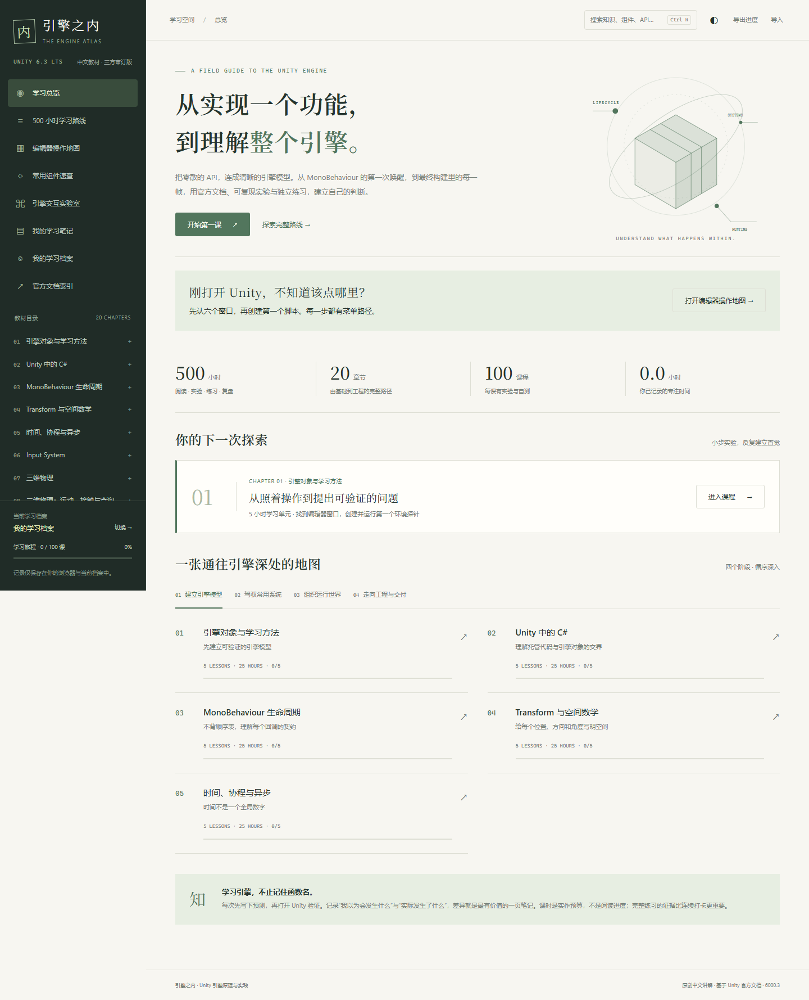

# Unity 引擎原理与实践 · 500 小时

**[在线学习](https://ranger1213123.github.io/unity-engine-academy/)** · [完整学习路线](https://ranger1213123.github.io/unity-engine-academy/#roadmap) · [生命周期课程](https://ranger1213123.github.io/unity-engine-academy/#lesson/l011)

**第一次用 Unity？先打开[编辑器操作地图](https://ranger1213123.github.io/unity-engine-academy/#editor)。** 六个窗口在哪里、怎样创建并挂载脚本、运行后在哪里看结果，都有菜单路径和逐步指引。

中文学习教材，基于 Unity 6.3 LTS 官方手册和脚本 API，面向有少量 C# 基础的学习者。双击 `index.html` 即可离线学习；官方参考链接需要网络。

本次讲解修订已逐课重写全书原理正文。每课先提出一个具体问题，再用至少三步例题解释过程，并提供可展开答案的预测题。术语在使用时解释，计算使用具体数字与单位；生命周期另有初始状态和协程停止规则的对照表。修订标准见 `EDITORIAL.md`，覆盖与核对记录见 `EDITORIAL-REVIEW.md`。

在此基础上，三类学者子智能体又按引擎机制、学习科学和中文科技写作三个方向复读全书，落实技术纠错、实验补全与讲解改进，并交叉复核高风险段落。本轮修订记录见 [三方审订说明](SCHOLAR-REVIEW.md)。

情景与操作补订又为100课导读、100份预测题、300道自测和200组实验补出各自的背景、用途与准备；第1课从找窗口开始。另用 Humanizer-zh 和 doc-coauthoring 的方法复读，并由不继承修订历史的读者盲测第1课。采用来源见 [写作 skills](WRITING-SKILLS.md)，具体修正和验证边界见 [情景与操作补订记录](CONTEXT-REVIEW.md)。

学习时间包含阅读、预测、引擎实验、独立练习和复盘。100 课 × 5 小时 = 500 小时；完成阅读并不自动代表完成课程。代码实验需在自己的 Unity 6.3 学习项目中执行。

进度、笔记、收藏、自测、实作验收与专注时间，都保存在当前浏览器的当前学习档案中。不同浏览器或浏览器用户配置互不影响。多人共用同一浏览器用户配置时，请在“我的学习档案”中各建一份独立档案，并在学习前切换到自己的档案；每个标签页分别保留所选档案，切换会保存当前内容并暂停计时。旧版记录会自动迁入第一份档案，原记录仍留作本机备份。

学习档案无需登录，也不上传到 GitHub。它不是带密码的账号；共用浏览器的人可以切换其中的档案。需要隔开私人内容时，请使用各自的浏览器用户配置。跨设备自动同步暂未提供，请定期“导出进度”，在目标浏览器的目标档案中导入恢复。清除网站数据或退出无痕窗口会丢失未备份的本机记录。离线文件、本地服务与 GitHub Pages 的记录也需要通过导出、导入迁移。

教材内容位于 `content/`，界面为 `index.html`、`styles.css` 和 `app.js`。`AUTHORING.md` 是内容规范，`REVIEW.md` 记录审校范围与限制，`sources-audit.json` 记录官方链接检查。

## 建议学习方法

1. 先用第 1 章建立实验记录：问题、预测、唯一变量、观察、解释、尚未排除的条件。
2. 有 C# 基础可用第 2 章自测定位缺口，重点理解 Unity 对象空值、序列化和引用所有权。
3. 第 3 章生命周期是主干，之后按先修链学习。不要把顺序图当成所有对象、所有播放模式的无条件保证。
4. 每课先读具体问题，跟着例题走一遍。预测题先自己回答，再展开解释；随后阅读原理，到自己的 Unity 项目验证。至少保存两组实验与独立练习的记录。
5. 自测达到 80%，并按 100 分标准完成实作自评后标记完成。网页只记录你的验收声明，不会替代 Unity 中的运行验证。
6. 每周导出学习记录，复盘一个“原来的模型被证伪”的例子。每周 10 小时约 50 周完成；课时可按实际学习情况调整。

## 网站功能

每课分步例题、预测问答、沉浸阅读、明暗主题、全文搜索、24 组常用组件速查、生命周期与固定步进示意实验、逐文件复制示例、自测解析、学习验收、收藏、笔记、实际专注计时、本机独立学习档案、按档案导出与恢复 JSON 备份，以及单课打印/PDF。交互实验是教学模型，真实行为仍需按官方文档在引擎中核验。

网站不需要安装依赖。可直接打开 `index.html`；如已安装 Node，也可运行 `npm start`，终端会显示本机地址。两种打开方式可能使用不同的浏览器存储，切换前请导出进度。

## 复核工具

`npm run check` 校验课时、内容完整性、先修、自测和评分。`npm run audit:sources` 在线检查官方引用。`scripts/compile-samples.mjs` 可使用本机 Unity 自带编译器做独立编译检查，路径可通过 `UNITY_ATLAS_EDITOR` 与 `UNITY_ATLAS_ASSEMBLIES` 调整；它不执行 Unity 场景。浏览器检查使用本机 Playwright 与已安装 Edge，运行依赖路径可通过 `UNITY_ATLAS_NODE_MODULES` 调整。

普通阅读和本地服务不需要安装依赖。若要运行浏览器检查，另行安装 Playwright 并准备 Edge，或通过环境变量指定现有依赖位置。编译检查需要本机 Unity 与相应包程序集。运行产生的本机报告、临时测试数据和修订前备份不进入仓库；保留的旧版正文基线仅供编辑审计对照。

`npm run test:learners` 检查访客与档案隔离、旧记录迁移、多标签页合并、按档案恢复、存储受限及损坏数据保护；只使用合成测试记录。`npm run test:learner-browser` 在真实浏览器中检查对应页面操作、独立访问者、移动布局与导出内容。

`npm run test:context-browser` 逐课核对情景、用途、预测背景、自测题设和实验准备的完整呈现及顺序，并检查这些内容可搜索、可打印，以及编辑器地图、混合代码文件和移动布局。

## 发布

GitHub Pages 使用 `main` 分支根目录发布，入口为 `index.html`，不需要打包。课程使用页面内路由，因此在线地址与离线文件都能正常导航。下载整个仓库后也可以直接打开本地入口。仓库只包含教材、界面、复核工具和合成测试；个人学习记录由浏览器生成，不进入仓库，也不随网站部署发布。
